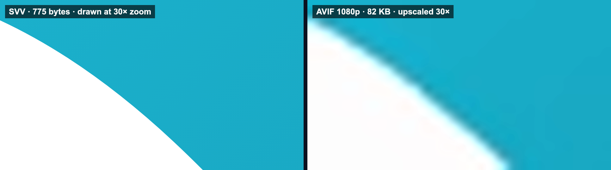

# SVV: Scalable Vector Video

> [!WARNING]
> **This is an experiment, not a finished format.** SVV is a prototype for testing an idea. The format, the tools and the player may change or break at any time, and files made today may not play in later versions. Don't use it in production.

**Video formats were made for video. Animation deserves its own.**

SVV is a file format for animation. It stores shapes and motion, not pixels and frames, so a file has no resolution and no frame rate. It plays sharp at any size and smooth at any speed, and it stays tiny.


*The SVV file behind this loop is 3.4 KB, smaller than the 15.7 KB still SVG it was drawn from. The GIF you are watching is 408 KB and stops at 960 pixels wide; the SVV file has no such limit.*

## Why

A camera records light landing on a grid of sensors, many times a second. For footage, pixels and frames are the truth, so codecs like H.264, AV1 and AVIF store pixels and frames. They do that job well.

Animation is not recorded. Someone drew a curve and told it where to be two seconds later. The curve has no resolution. The motion has no frame rate. Both come into being only when the animation is exported to a video file, and at that moment the work gets capped: 1080p, 24 fps, for good. Zoom in and it blurs. Show it on a bigger screen and it blurs. Slow it down and it stutters. Ten years on, someone has to dig up the project files to remaster it, if they still exist.

SVV keeps what the animator made: shapes, and how they move over time. A file holds Bézier curves, text, gradients, masks, blurs and glows, each driven by keyframes on a continuous timeline. The player works out each frame at the moment it is shown, for the screen in front of it.

So there is no 480p version of an SVV file, and no 4K version. There is the file.

- **No resolution.** Play it on a watch or across a stadium screen. Edges stay sharp at any size, because every frame is drawn at the size it is shown.
- **No frame rate.** A 60 Hz screen gets 60 frames a second, a 240 Hz screen gets 240, each sampled at its exact time. Slow it down tenfold and the motion stays smooth, because every in-between exists.
- **Nothing to remaster.** A file made today will look right on screens that don't exist yet. The format is written down to the bit in [SPEC.md](SPEC.md), so anyone can build a player for it, long after this one is gone.
- **Tiny.** Math is cheap to store. Every example in this repo stays under 8 KB for 4 to 10 seconds of animation.



## Quick start

Requires [Bun](https://bun.sh). Rendering to video also needs `ffmpeg` built with `libsvtav1`, `libdav1d` and `libopus`.

```sh
bun install
bun src/cli.ts encode examples/scenes/titles.ts -o titles.svv
bun src/cli.ts render titles.svv -o titles.mp4 --width 3840 --fps 120
bun run demo           # serves the example player on http://localhost:8080
```

To play a file in a web page, build the player with `bun run build:player` and add:

```html
<script type="module" src="svv-player.js"></script>
<svv-player src="titles.svv" autoplay style="width: 100%"></svv-player>
```

## Results

Five test clips at 1280×720 and 24 fps, against animated AVIF (SVT-AV1) at the same SSIM ([BENCHMARKS.md](BENCHMARKS.md) has the method):

| Clip | SVV | AVIF at the same SSIM | |
|---|---:|---:|---|
| Motion graphics (text, masks, glow, blur, blend modes) | **3.6 KB** | AVIF can't reach it; its smallest file is 16.4 KB | 4.6× smaller |
| Rigged cut-out character | **1.2 KB** | AVIF can't reach it; its smallest file is 23.1 KB | 19× smaller |
| Hand-drawn, traced from video | **28.4 KB** | 29.6 KB | AV1 inside SVV, 4% smaller |
| Anime with painted background, traced from video | **227.5 KB** | 228.7 KB | AV1 inside SVV, 1% smaller |
| 3D-rendered toon, traced from video | **24.0 KB** | 25.2 KB | AV1 inside SVV, 5% smaller |

When animation is made as shapes, SVV is several times smaller than any AVIF, at higher quality, at every size and frame rate.

When animation exists only as pixels, the honest answer is different. `svv trace` turns video back into shapes, but hand-drawn line boil, painted texture, grain and 3D shading cost more as traced shapes than as AV1. In those cases SVV stores the AV1 stream inside the file instead, and ties AVIF rather than beating it. The real win comes from exporting animation straight from the tool that made it, before it ever becomes pixels.

In Chrome, every example plays at the display's full rate at 2560×1440, with under 1 ms of main-thread work per frame.

## Status

SVV is an experiment. It works well enough to test the idea, but it isn't finished:

- Scenes are written in code. There is no import from After Effects, Lottie or Figma yet.
- The web player has been tested in Chrome only. Video layers need WebCodecs with AV1, which some Safari versions lack.
- The player has no on-screen controls.
- The format is at version 2 and will change. There is no promise that later players will read today's files.

## Writing scenes

Scenes are plain objects. Helpers build common shapes, `parseSvgPath` takes any SVG path string, and `fontFromBytes` embeds the glyphs a string needs from a TTF or OTF file.

```ts
import { readFileSync } from 'node:fs'
import { encode, ellipse, fontFromBytes, rect, star, type Scene } from 'svv'

const font = fontFromBytes(readFileSync('Inter.ttf'), 'Hello')

const scene: Scene = {
  width: 1920,
  height: 1080,
  duration: 2,
  background: [15, 23, 42, 255],
  assets: [font],
  nodes: [
    {
      type: 'shape',
      path: [
        { t: 0, v: ellipse(960, 540, 200), ease: 'easeInOut' },
        { t: 1, v: star(960, 540, 260, 110, 5), ease: 'easeInOut' },
        { t: 2, v: ellipse(960, 540, 200) },
      ],
      fill: { type: 'solid', color: [99, 102, 241, 255] },
      filters: [{ type: 'glow', radius: 24, color: [129, 140, 248, 255] }],
    },
    {
      type: 'text',
      text: 'Hello',
      font: 0,
      size: 120,
      align: 'center',
      fill: { type: 'solid', color: [255, 255, 255, 255] },
      transform: { x: 960, y: 580 },
      mask: { node: { type: 'shape', path: rect(-400, -150, 800, 200), fill: { type: 'solid', color: [0, 0, 0, 255] }, transform: { x: [{ t: 0, v: -800 }, { t: 1, v: 0 }] } } },
    },
  ],
}

await Bun.write('hello.svv', encode(scene))
```

See `examples/scenes/` for complete scenes: `portrait.ts` loads an SVG drawing and animates it with eyelids, glints and pulsing lines layered over the art, `titles.ts` is a title sequence, and `cutout.ts` is a rigged character.

## Reference

### Command line

```sh
bun src/cli.ts encode examples/scenes/titles.ts -o titles.svv
bun src/cli.ts info titles.svv
bun src/cli.ts render titles.svv -o titles.mp4 --width 3840 --fps 120
bun src/cli.ts render titles.svv -o detail.png --width 2048 --view 600,450,320,180 --time 2
bun src/cli.ts render titles.svv -o frame.svg --time 2
bun src/cli.ts trace cartoon.mp4 -o cartoon.svv
```

`render` writes `.mp4`, `.webm`, `.mkv`, `.avif`, `.gif`, `.png` or `.svg`, and mixes in the file's audio when the format allows. `--view x,y,w,h` picks a region of the scene to fill the output. `trace` accepts `--mode auto|vector|av1`, `--colors`, `--tolerance`, `--plate auto|raster|none` and `--chunk`.

### Web player

The element sizes its canvas to its layout size times `devicePixelRatio` and redraws on every animation frame. Attributes: `fps` (lock to a frame rate, `0` = display rate), `playbackrate`, `view` and `muted`. It exposes `play()`, `pause()`, `currentTime` and `duration`. `bun run build:player` writes the minified bundle (about 40 KB) to `dist/`.

### Features

| | |
|---|---|
| Shapes | Explicit Bézier paths and point-only spline paths, solid and gradient fills, strokes, morphing between any two shapes |
| Motion | Keyframes with linear, hold, CSS cubic-bezier and smooth (continuous velocity) easing on every property |
| Effects | Masks (normal and inverted), 16 blend modes plus additive, blur, glow, drop shadow, isolated group opacity |
| Text | Embedded fonts, subset to the characters used, with kerning, alignment, letter spacing and line height |
| Media | AVIF, WebP, PNG and JPEG images; AV1 video layers decoded with WebCodecs; Opus audio |
| Delivery | 10-second self-contained chunks with an index up front; HTTP range requests for seeking; progressive playback when ranges aren't available |
| Conversion | `svv trace` turns existing video into SVV: shapes linked across frames, a raster background plate for camera pans, and an AV1 fallback per chunk |

## How it works

- **Model.** A scene is a tree of shapes, text, images, video layers, groups and instances. Every animated property is a keyframe track, and the player samples tracks at the exact time of each display frame.
- **Prediction.** Path points are coded as differences from the previous point, and Bézier handles as differences from a smooth continuation. Later keyframes are coded against the best of four predictions from earlier keyframes. Number tracks pick a predictor too.
- **Back-references.** Recently used colors, timings, tracks and paths are kept in short lists, and a repeat costs one small index.
- **Entropy coding.** An LZMA-style binary range coder with adaptive probabilities, one set per kind of field.
- **Chunks.** A chunk holds every node, def and keyframe needed for its time range, so it decodes alone. The index up front lists every chunk's byte range and the fonts and images it needs.
- **Tracing.** `svv trace` builds a palette, segments each frame into stacked regions that meet without seams, and fits spline outlines. It follows each outline from frame to frame, so a moving shape becomes one path track rather than a new shape per frame. Then it compares that against AV1 at the same SSIM, chunk by chunk, and keeps the smaller.

[SPEC.md](SPEC.md) defines the format down to the bit.

## Development

```sh
bun test               # codec, effects, text, media, chunks, tracer, player, fuzzing
bun run check:browser  # drives Chrome to check the web player (set CHROME to its path)
bun run perf           # plays each example in Chrome and counts frames shown
bun run bench          # the AVIF comparison (needs ffmpeg)
```

### Repository layout

| Path | Contents |
|---|---|
| `src/model.ts` | Scene types |
| `src/rangecoder.ts` | Range coder and integer coding |
| `src/codec.ts` | Container, chunks, `encode` / `decode`, streaming index reader |
| `src/chunk.ts` | Cutting a scene into self-contained chunks |
| `src/path.ts` | Path helpers, splines, SVG path parser, morph matching |
| `src/evaluate.ts` | Track sampling and the render tree |
| `src/render.ts` | Canvas 2D renderer with layers, masks and filters (browser and Node) |
| `src/text.ts`, `src/font.ts` | Text layout; font subsetting from TTF/OTF |
| `src/player.ts` | Streaming source, `SvvPlayer` and the `<svv-player>` element |
| `src/node.ts`, `src/media.ts` | PNG/video output; image, AV1 and Opus asset helpers (ffmpeg) |
| `src/svg.ts` | Export one frame as SVG |
| `src/trace/` | Video tracer and the per-chunk AV1 fallback |
| `src/cli.ts` | `svv` command |
| `examples/` | Example scenes, fonts (OFL) and the demo page |
| `bench/` | Test clip generators, AVIF comparison, playback speed and browser check |

## License

MIT. The example fonts, Bangers and Lilita One, are under the SIL Open Font License; see their folders.
